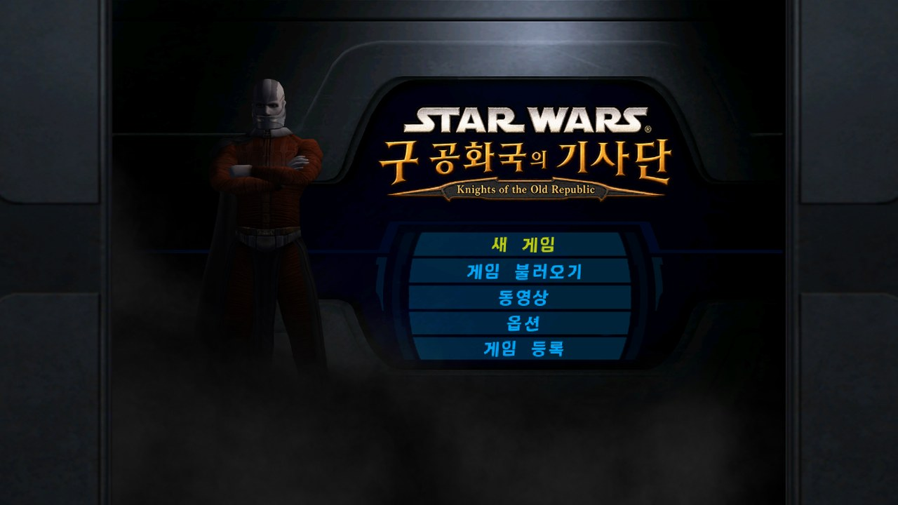

<div align="center">

# 스타워즈: 구 공화국의 기사단
### Star Wars: Knights of the Old Republic · Nintendo Switch 한글패치


-555)


[](https://www.sacheon.go.kr/intro/01096/05083.web)

**[⬇ 다운로드 (Releases)](../../releases/latest)** · **[버그 제보 (Issues)](../../issues)**

</div>

---

## 한글화 범위

| 항목 | 내용 | 상태 |
|---|---|:---:|
| 대사·선택지 | `dialog.tlk` 전체 | ✅ |
| 아이템·능력·퀘스트 일지 | `dialog.tlk` 전체 | ✅ |
| 글꼴 | [사천항공체](https://www.sacheon.go.kr/intro/01096/05083.web) 비트맵 3장 (`krfont0~2`) | ✅ |
| 글자 출력 | 실행 파일 한글 출력 처리 | ✅ |
| 이미지 속 글자 | 로고·일부 UI 그림 | ➖ 원문 |

## 스크린샷

<div align="center">



<sub>Eden 에뮬레이터 · 업데이트 1.0.4</sub>

</div>

## 준비물

| | |
|---|---|
| 게임 | 본편 + 업데이트 **1.0.4 (v262144)** |
| 타이틀 ID | `0100854015868000` · 업데이트 `0100854015868800` |
| 업데이트 NSP | 본인 덤프 `…[0100854015868800][USA][v262144].nsp` |
| 키 | 본인 기기의 `prod.keys` |

> 게임 파일과 키는 포함하지 않습니다. 키트가 본인 업데이트에서 실행 파일을 꺼내 한글판으로 바꿉니다.

## 적용

```
① 압축 해제          ② 같은 폴더에 넣기              ③ 실행             ④ 결과
KOTOR_Switch_KR  →   + 업데이트 NSP               →  make_mod.bat   →  out\
  make_mod.bat       + prod.keys                     엔터 두 번          ├ atmosphere\   (스위치)
  patch\ romfs\                                                         └ eden_mod\     (에뮬)
  tools\
```

| 환경 | 넣는 곳 |
|---|---|
| 스위치 (Atmosphere) | `out\atmosphere\` → SD 카드 루트 |
| 에뮬 (Eden 등) | `out\eden_mod\KOTOR_KR\` → 게임 우클릭 → 모드 폴더 열기 |

다른 위치의 파일을 쓰려면 엔터 대신 경로 입력. Eden 키 기본 위치: `%APPDATA%\eden\keys\prod.keys`

## 결과 확인

```
exefs/main   SHA-1 7814c04fd6ce7fa85734c2b4abc361a41b6a6a50   8,390,612 bytes
dialog.tlk   SHA-1 112ab09f5a6f099ee40bf17efe24845bfe704679   5,981,971 bytes
```

키트가 마지막에 직접 대조합니다. 전체 목록은 `hashes.txt`.

## 자주 묻는 질문

<details><summary>키는 왜 필요한가요?</summary>

실행 파일(`main`)은 업데이트 안에 암호화돼 있습니다. 키트가 본인 키로 꺼내서 한글 처리를 덧씌웁니다. 키는 키트 밖으로 나가지 않고, 화면에도 출력하지 않습니다.
</details>

<details><summary>1.0.4 외 버전은 안 되나요?</summary>

안 됩니다. 실행 파일이 버전마다 달라서, 키트가 원본 해시를 확인하고 다르면 멈춥니다.
</details>

<details><summary>PC판 한글패치와 뭐가 다른가요?</summary>

Switch 판 전용입니다. 패드 조작·휴대 모드 그대로 한글로 플레이합니다.
</details>

<details><summary>"no usable keys" / "hactool missing" 이 뜹니다</summary>

zip 을 통째로 푼 폴더에서 실행했는지, `prod.keys` 가 그 폴더에 있는지 확인하세요. `tools\` 폴더가 빠지면 동작하지 않습니다.
</details>

## 파일

| 파일 | 내용 |
|---|---|
| `KOTOR_Switch_KR_v0.900.zip` | `make_mod.bat` · `patch/main.xdelta` · `romfs/` · `tools/` |
| `hashes.txt` | 원본·결과·패치 해시 |

`tools/` 의 hactool (ISC) · xdelta3 (Apache 2.0) 라이선스 동봉.

## 버전 기록

| 버전 | 날짜 | 내용 |
|---|---|---|
| v0.900 | 2026-10-16 | 첫 배포 |

## 제작

글꼴: **[사천항공체](https://www.sacheon.go.kr/intro/01096/05083.web)** — 경상남도 사천시가 무료로 배포하는 전용서체(제작 산돌티움). 비트맵으로 변환해 사용했습니다.

비영리 개인 제작. 원본 게임의 권리는 Lucasfilm · BioWare · Aspyr 에 있습니다.
